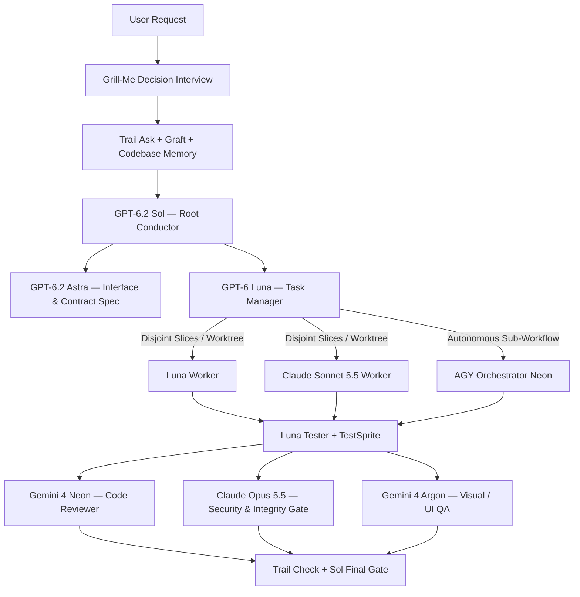

# Sol–Luna Full-Set Orchestra

[](https://github.com/dontworryplz/Oh-My-Orkestra/actions/workflows/test.yml)
[](./LICENSE)
[](#architecture-overview)

> **Multi-Harness AI Engineering Orchestra** for **OMP (`oh-my-pi`)**, **Antigravity CLI (`agy`)**, and **Claude Code** — combining **GPT-6.2 Sol**, **GPT-6.2 Astra**, **GPT-6 Luna**, **Claude Opus 5.5 / Sonnet 5.5**, and **Gemini 4 Neon / Hydrogen / Argon / Orchestrators** with controlled nested spawning, STRIDE security gates, isolated `git worktree` execution, telemetry, and 5 integrated sidekick systems.

---

## Architecture Overview



---

## Model & Specialist Topology

Every model has a dedicated, non-overlapping mission. No legacy `5.6` or `6.1` models are used.

| Role / Agent | Engine / Model | Harness | Mission & Authority |
|---|---|---|---|
| **Root Conductor** | `openai-codex/gpt-6.2-sol` | OMP / Root | Decomposition, architecture, integration, final gate |
| **Task Manager** | `luna-task-manager` (`gpt-6-luna:max`) | OMP (`task` + `bash`) | Breaks phases into DAGs, spawns OMP & `agy` subagents |
| **Architecture Analyst** | `astra-architect` (`gpt-6.2-astra:high`) | OMP | Cross-slice contracts, invariants, edge-case modeling |
| **Research Analyst** | `terra-analyst` (`gpt-6-luna:max`) | OMP | Primary-source docs (`context7`), version/API verification |
| **Core Worker** | `luna-worker` (`gpt-6-luna:max`) | OMP (`task` + `bash`) | Bounded implementation with disjoint file ownership |
| **Empirical Tester** | `luna-tester` (`gpt-6-luna:max`) | OMP | Real test execution (`TestSprite`, unit/integration/e2e) |
| **Code Reviewer (Neon)** | `neon-code-reviewer` (`agy: gemini-4-neon-xhigh`) | AGY CLI | Read-only deep code review, logic bugs, contract drift |
| **Deep Debugger (Hydrogen)** | `hydrogen-debugger` (`agy: gemini-4-hydrogen-xhigh`) | AGY CLI | Root-cause tracing, race conditions, algorithmic bugs |
| **1M Explorer (Argon)** | `argon-explorer` (`agy: gemini-4-argon-high`) | AGY CLI | Broad 1M-context repo mapping, log/trace synthesis |
| **Sub-Orchestrator** | `agy-orchestrator` (`agy: gemini-pro-orchestrator-neon`) | AGY CLI | Autonomous multi-step sub-workflow (Depth-2 nesting) |
| **Security Gatekeeper** | `security-reviewer` / `opus-auditor` (`claude-opus-5-5:high`) | OMP / Anthropic | AuthN/AuthZ/BOLA, SSRF, SQLi, secrets, dual-model red-team |
| **Threat Modeler** | `threat-modeler` (`agy: claude-opus-5-5-high`) | AGY CLI | Pre-code STRIDE threat modeling & abuse cases |
| **Infra / DevOps Auditor** | `infra-devops-auditor` (`gpt-6.2-sol:high` + `aws-mcp`) | OMP | IAM least-privilege, Docker, CI/CD, CORS/CSP/TLS |
| **Perf Profiler** | `perf-profiler` (`agy: gemini-4-hydrogen-xhigh`) | AGY CLI | N+1 queries, memory leaks, lock contention, latency |
| **Visual / UI QA** | `ui-qa-reviewer` (`gemini-4-argon:high`) | OMP / AGY | Responsive layout, WCAG 2.2 AA, console/hydration QA |
| **Parallel Worker (Claude)** | `sonnet-worker` (`claude-sonnet-5-5:high`) | OMP / Anthropic | Disjoint coding, UI/API integration, clean refactors |

---

## Integrated Sidekick Systems (`integrations/`)

1. **Grill-Me** ([integrations/grill-me.md](./integrations/grill-me.md)) — Relentless branch-by-branch decision interview before ambiguous or architectural work, always stating the recommended option first.
2. **Caveman** ([integrations/caveman.md](./integrations/caveman.md), `juliusbrussee/caveman`) — `caveman-lite` / `full` / `ultra` compression for inter-agent reports while preserving exact `file:line`, symbols, commands, and errors verbatim.
3. **Trail-Code** ([integrations/trail-code.md](./integrations/trail-code.md), `trailhq/Trail-Code`) — `trail ask` before exploring, `trail note` when uncovering non-obvious root causes/decisions, `trail check` before commit.
4. **GSD-Core** ([integrations/gsd-core.md](./integrations/gsd-core.md), `open-gsd/gsd-core`) — Maps `.planning/` GSD phases (`map-codebase`, `discuss`, `plan`, `execute`, `validate`, `code-review`, `secure`) to Orchestra specialists.
5. **Active MCP Routing** ([integrations/active-mcps.md](./integrations/active-mcps.md)) — Routes specialists to `graft`, `codebase-memory-mcp`, `trail`, `context7`, `TestSprite`, `aws-mcp`, `node_repl`, and `colab-mcp`.

---

## Installation

### One-Command Full Setup

```bash
git clone https://github.com/dontworryplz/Oh-My-Orkestra.git
cd Oh-My-Orkestra
chmod +x ./install.sh
./install.sh --all
```

### Installer Flags

| Flag | What It Does |
|---|---|
| *(default)* | Installs skill + `omp-agents/*.md`, links to OMP/Claude/AGY, installs/links Caveman, Trail-Code, and GSD-Core, creates `config.yml` if missing, runs `doctor` |
| `--all` | Enables `--with-config` + `--sync-mcps` + `--with-hooks` |
| `--with-config` | Backs up existing `~/.omp/agent/config.yml` (`config.yml.bak.<ts>`) and applies `config/config.example.yml` |
| `--sync-mcps` | Syncs `graft`, `codebase-memory-mcp`, `context7`, `TestSprite`, `aws-mcp`, `trail` into OMP & AGY MCP configs |
| `--with-hooks` | Installs `hooks/pre-commit` into the current Git repo (if inside a git repository) |
| `--skip-sidekicks` | Skips cloning/installing external `caveman`, `trail-code`, `gsd-core` |
| `--dry-run` | Prints planned actions without modifying any files |

---

## Usage & CLI Reference

### 1. Unified `orchestra` CLI

```bash
orchestra init                             # Auto-discover repo tech stack & write .orchestra/REPO_MAP.md
orchestra doctor                           # Verify agy CLI, models & roles
orchestra stats                            # Telemetry ledger (runs, 429s, latency)
orchestra sync-mcps                        # Sync Claude/Codex MCPs into OMP & AGY
orchestra route [--staged]                 # Smart diff/risk agent recommendations
orchestra review [--staged] [--auto-fallback]  # Structured Neon Code Review
orchestra worktree --role sonnet-worker --repo "$PWD" --prompt "..."
```

### 2. Run an AGY Specialist Directly (with `--auto-fallback`)

```bash
# Read-only Neon Code Review with strict JSON Schema + automatic 429 model fallback
python3 ~/.omp/agent/skills/sol-luna-orchestrator/scripts/agy_agent.py run \
  --role neon-reviewer \
  --auto-fallback \
  --cwd "$PWD" \
  --schema ~/.omp/agent/skills/sol-luna-orchestrator/config/review-schema.json \
  --prompt "Review staged git diff for logic bugs, auth boundaries, and missing edge cases."

# Fast Bash preset
~/.omp/agent/skills/sol-luna-orchestrator/scripts/agy-run.sh hydrogen-debugger -- "Trace why auth refresh races on concurrent 401s"
```

> **Important `agy` CLI quirk:** Always attach the prompt with `=` (`-p="..."`). Never pass `-p --model ...` or `agy` will consume `--model` as the prompt string. Both `agy_agent.py` and `agy-run.sh` handle this automatically.

### 3. Isolated `git worktree` Execution for Parallel Writers

```bash
~/.omp/agent/skills/sol-luna-orchestrator/scripts/worktree-run.sh \
  --role sonnet-worker --repo "$PWD" --keep \
  --prompt "Implement pagination in src/api/users.ts and its unit tests."
```

### 4. Optional Strict Pre-Commit Gate

```bash
# Enables trail check + Neon Code Reviewer P0/P1 gate on staged diffs
ORCHESTRA_REVIEW_GATE=1 git commit -m "feat: add tenant-scoped billing"
```

---

## Testing

```bash
python3 -m unittest discover -s tests -p "test_*.py" -v
```

Tests use a mocked `agy` executable (no live account or quota required) and verify `doctor`, `plan`/`auto` modes, `429` quota non-fabrication, fail-closed unknown models, `--schema`, and `stats` telemetry.

---

## Repository Structure

```text
sol-luna-orchestrator/
├── SKILL.md                      # Master orchestration contract
├── README.md                     # Full documentation
├── LICENSE                       # MIT License
├── install.sh                    # Multi-harness self-installer
├── config/
│   ├── roles.json                # AGY role-to-model routing
│   ├── config.example.yml        # Portable OMP config
│   └── review-schema.json        # Strict JSON schema for review gates
├── topology/
│   ├── model-roster.md           # Verified model catalog
│   └── role-matrix.md            # Role boundaries & authority
├── agy-bridge/
│   ├── cli-protocol.md           # `agy` CLI invocation rules
│   └── nested-spawning.md        # Depth-2 nested agent guardrails
├── workflows/
│   ├── delegation-protocol.md    # Task decomposition & parallel batching
│   ├── review-and-qa-gates.md    # Multi-model QA pipeline
│   ├── security-hardening.md     # STRIDE, OWASP, red-team gate
│   ├── session-handoff.md        # `.orchestra/handoff.md` continuity
│   └── fallback-and-recovery.md  # 429 fallback chains & recovery
├── integrations/
│   ├── grill-me.md               # Decision interview protocol
│   ├── caveman.md                # Token-compressed reporting
│   ├── trail-code.md             # Trail-Code institutional memory
│   ├── gsd-core.md               # GSD phase mapping
│   └── active-mcps.md            # MCP server routing
├── omp-agents/                   # Portable OMP agent definitions
├── scripts/
│   ├── agy_agent.py              # Python adapter (doctor, run, stats)
│   ├── agy-run.sh                # Fast Bash preset runner
│   ├── worktree-run.sh           # Isolated git worktree runner
│   └── sync-mcps.py              # Claude/Codex -> OMP/AGY MCP sync
├── hooks/
│   └── pre-commit                # Optional trail + Neon review gate
├── examples/
│   └── orchestra-flows.md        # End-to-end flow examples
└── tests/
    └── test_agy_agent.py         # Unit test suite
```
